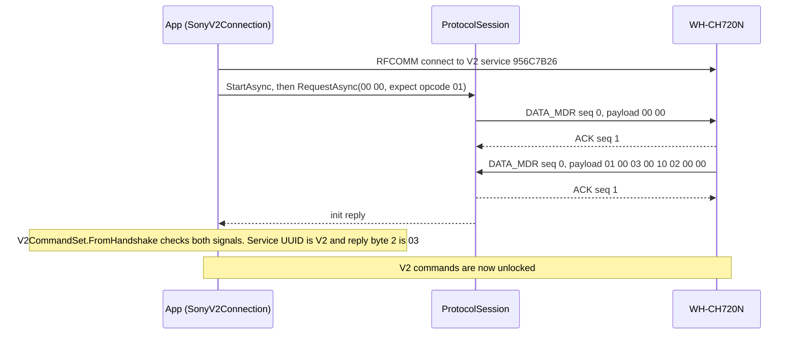
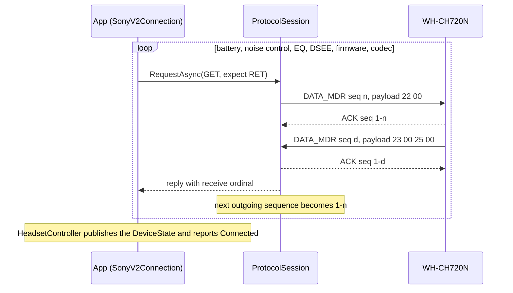
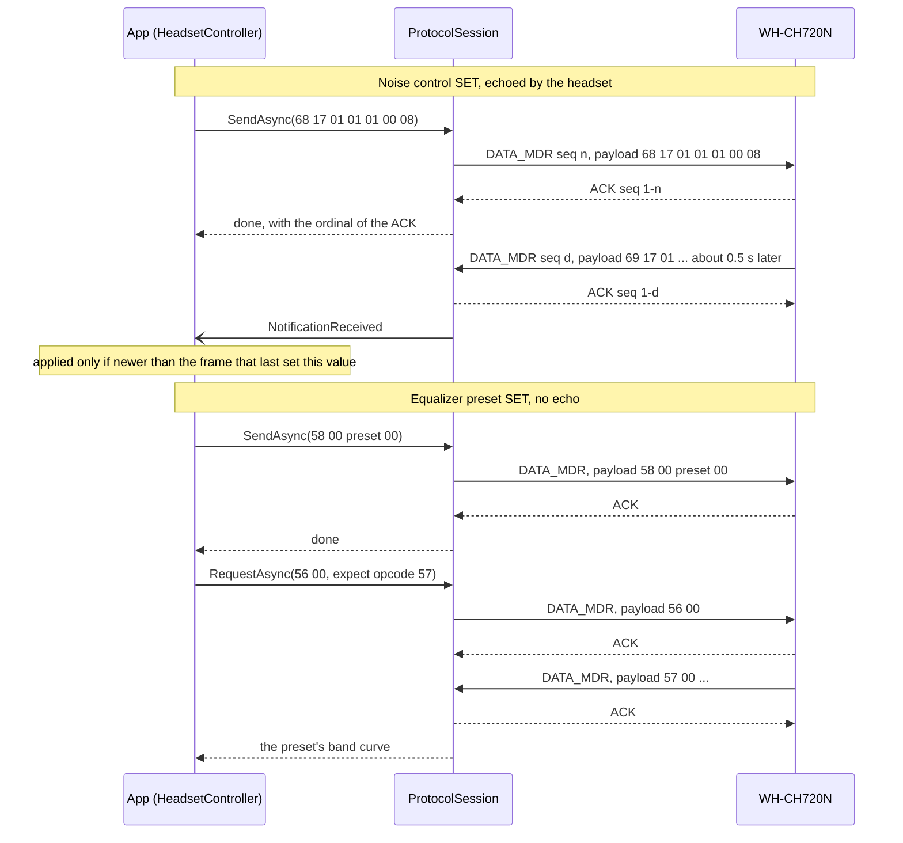
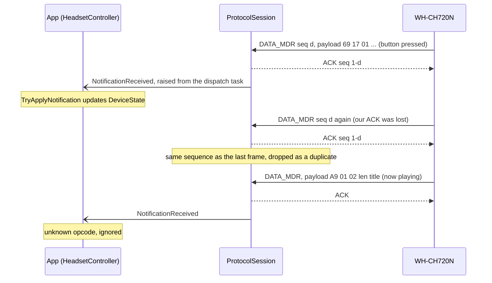
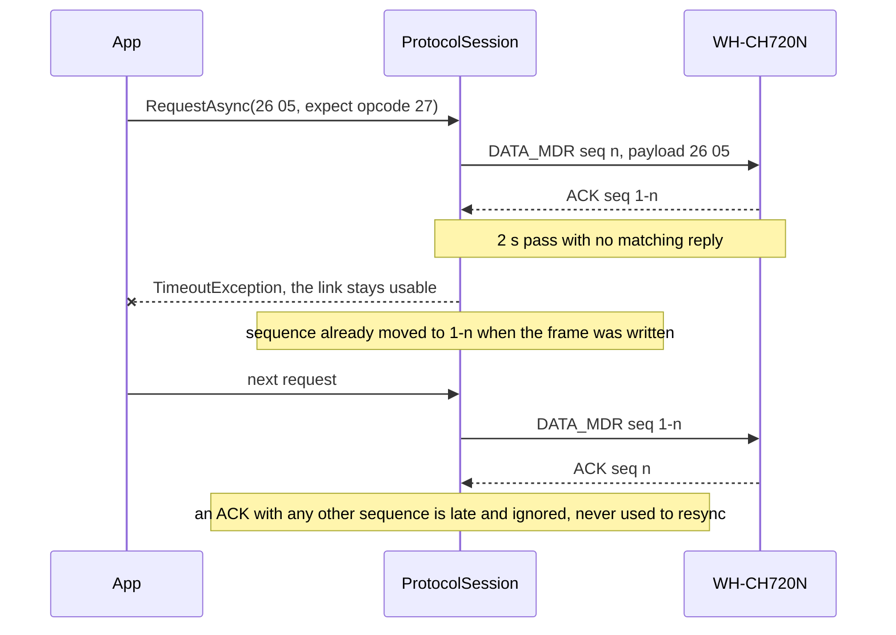

# How the app talks to the WH-CH720N

Five exchanges over one Bluetooth RFCOMM byte stream, as implemented in `ProtocolSession` and `SonyV2Connection`. Payload bytes are the ones captured from the real headset on firmware 1.1.4 (see `development-status.md`).

The headset's own sequence numbers are shown as `d` except in the handshake, because only the handshake value was captured. The host sequence numbers in the settings table are derived from the alternation rule in the code, not from a capture.

## The frame every arrow carries

Each arrow in the diagrams below is one frame. Only two frame types are used: `DATA_MDR` (type `0C`) carries a command payload, and `ACK` (type `01`) has an empty payload.

The init handshake request exactly as sent, `3E0C000000000200000E3C`:

| Bytes | Field | Notes |
|---|---|---|
| `3E` | start marker | |
| `0C` | type | `DATA_MDR` |
| `00` | sequence | 0 or 1 |
| `00 00 00 02` | payload length | big-endian |
| `00 00` | payload | opcode, subtype |
| `0E` | checksum | sum mod 256 of type, sequence, length and payload |
| `3C` | end marker | |

Inside the markers, bytes `3C`, `3D` and `3E` are escaped as `3D` followed by the byte minus `10`. The checksum is computed before escaping.

In a payload, byte 0 is the opcode and byte 1 is usually a subtype. Opcode families follow one pattern: `GET = n`, `RET = n+1`, `SET = n+2`, `NTFY = n+3`.

## 1. Connect and handshake

The app opens RFCOMM to the V2 service, then sends the one command that is safe on every headset generation. Nothing else goes out until the reply proves the headset is V2, because opcode `22` reads the battery on V2 but powers the headset off on V1.

An ACK always carries 1 minus the sequence of the frame it acknowledges, in both directions. A request completes on the matching reply, so the ACK in between is not waited for.

## 2. Reading the settings

Right after the handshake the app reads six settings, one request at a time. Each is a two-byte GET, and the headset ACKs it before sending the RET. The session matches the reply by opcode, and by subtype for battery and DSEE.

The battery query is shown. The host sequence alternates after every frame it writes: the handshake used 0, so battery goes out as 1, noise control as 0, and so on. The headset keeps its own sequence `d` for the frames it sends.

| Setting | Host seq | GET sent | RET received | Meaning |
|---|---|---|---|---|
| Battery | 1 | `22 00` | `23 00 25 00` | 37 %, not charging |
| Noise control | 0 | `66 17` | `67 17 01 01 01 00 08` | Ambient, voice focus off, level 8 |
| Equalizer | 1 | `56 00` | `57 00 10 06 09 0A 0F 11 11 13` | Bright; clear bass −1; bands 0, 5, 7, 7, 9 |
| DSEE | 0 | `E6 01` | `E7 01 00` | Off |
| Firmware | 1 | `04 02` | `05 02 05 "1.1.4"` | 1.1.4 |
| Codec | 0 | `12 02` | `13 02 02` | AAC |

A query that times out or returns a malformed reply leaves that one setting unknown. It does not fail the connection.

## 3. Changing a setting

A SET has no reply frame. `SendAsync` completes as soon as the headset ACKs it. What happens next depends on the setting: noise control and DSEE are echoed back as a notification about half a second later, and an equalizer preset is not, so the app reads the equalizer again.

The noise-control payload is version `01`, effect on, ambient type, voice focus off, level 8. A DSEE SET (`E8 01 xx`) behaves like noise control and is echoed as `E9 01 xx`.

## 4. Frames the headset sends on its own

The headset also talks without being asked: battery changes, the physical NC/Ambient button, now-playing metadata. The session ACKs every non-ACK frame first, because the headset retransmits anything that is not ACKed. A retransmission arrives with the same sequence as the frame before it, so it is ACKed again and dropped.

Known notification opcodes are `25` battery, `59` equalizer, `69` noise control and `E9` DSEE. Anything else, such as `A5 01`, `A9 01`, `E5 01 00` and `15 03`, is ACKed and ignored.

## 5. When the headset does not answer

One deadline of 2 seconds covers the write and the wait. The session never retransmits on its own; the caller decides. The example is the auto power-off query from an earlier version of the app, which this firmware ACKs but never answers.

If the link itself drops, pending calls fail with `TransportException`, the session raises `Disconnected`, and the connection cannot be reused.

## Rules that hold in every exchange

- One request is in flight at a time. The session serializes callers with a lock.
- The sequence is one bit per direction. The host flips its own after each frame it writes, and only the ACK for the frame in flight counts.
- Every received frame gets a receive ordinal. The app uses it to order replies, ACKs and notifications, so an old notification cannot undo a newer SET.
- Notifications are raised from a separate dispatch task, never from the receive loop, so a handler can send a request of its own.
- Only one RFCOMM connection to the control service can be open. A second one fails with `0x80072740`.
